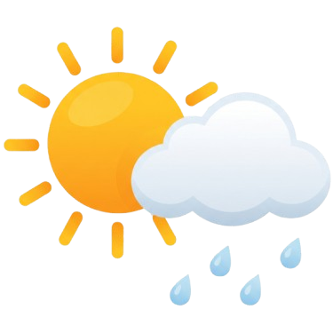
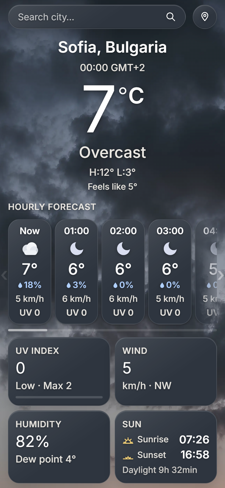
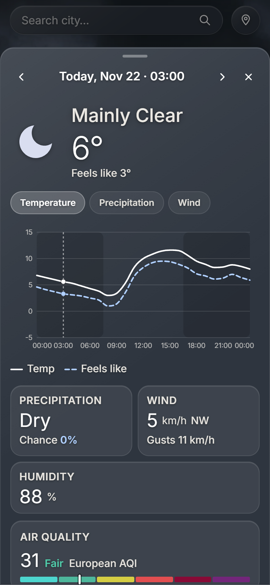
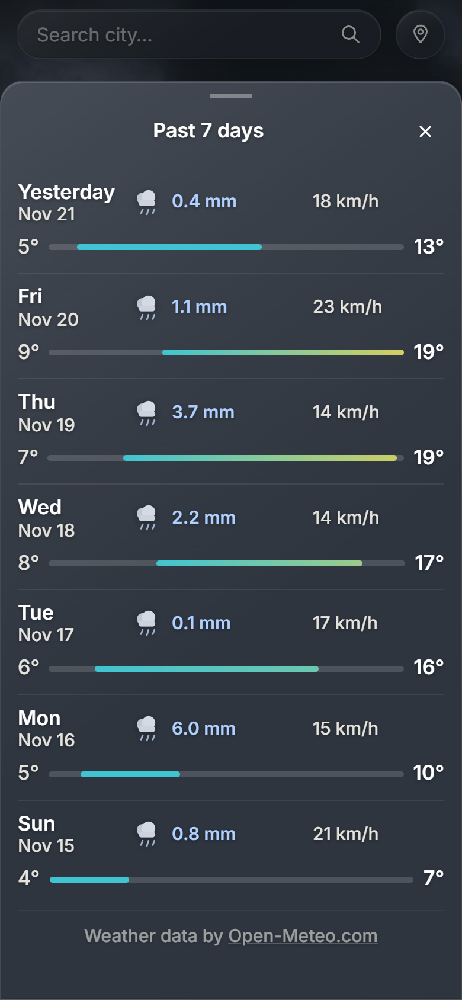
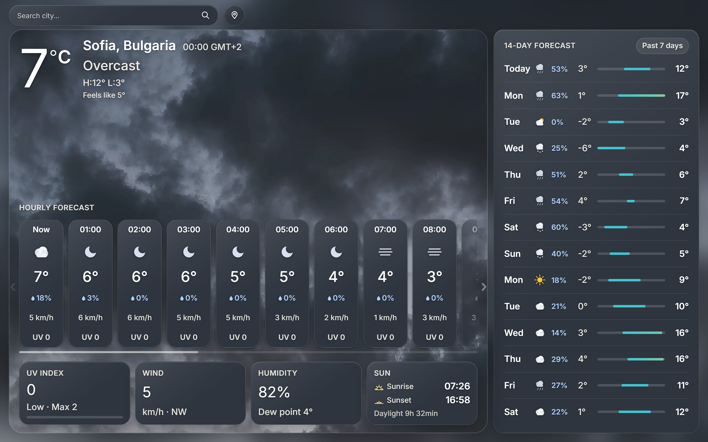
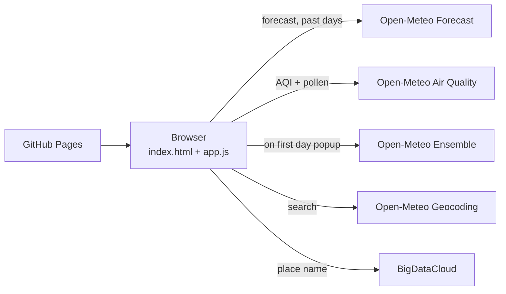

<div align="center">



# Weather · ivanovp.site

**A phone-first weather app on real photographs.**<br />
Live conditions, the next 24 hours and 14 days ahead, and the week that just passed.

[](https://ivanovp.site)
&nbsp;
[](https://github.com/PetarIvanov03/Weather/actions/workflows/pages/pages-build-deployment)

Vanilla JavaScript &nbsp;·&nbsp; Hand-written CSS &nbsp;·&nbsp; Open-Meteo &nbsp;·&nbsp; PWA &nbsp;·&nbsp; GitHub Pages

</div>

<br />

<p align="center">
  
  &nbsp;
  
  &nbsp;
  
</p>

<p align="center">
  
</p>

## ✨ Highlights

**Everyday use**
- 🌤️ **At a glance:** temperature in °C, condition, high/low and feels-like over a photo that matches the weather and the time of day.
- 🕐 **Next 24 hours:** a swipeable rail of hour cards (4 on small phones, 4½ on larger ones) with arrows and a thin position line.
- 📅 **14 days ahead** with a low/high bar per day, and **the past 7 days** one tap away.
- 🔎 **Tap for detail:** every hour and every day opens a short popup with a smooth chart and a few small tiles.
- 📍 **Remembers your city**, or finds you with geolocation on the first visit.

**Built to be easy to read**
- 🔠 **Large, bold text** that stays readable on bright day photos (pure white with a soft shadow).
- 🧩 **Only what matters:** visibility, thunderstorms, snow and UV tiles appear only when they are relevant.
- 🎞️ **Smooth motion:** the popup slides like a native sheet; everything respects `prefers-reduced-motion`.
- 📱 **Phone first:** checked at 360–393 px, with a 70/30 split layout from 768 px up.

**Built to be simple**
- 🪶 **No framework, no build step, no backend, no API keys** — three source files served as they are.
- 🔄 **Silent refresh** when you come back after 10 minutes; the clock keeps ticking in between.
- 📲 **Installable PWA** with its own icon and link preview.

## 🧱 How it is built

| Layer | Choice |
| :-- | :-- |
| Frontend | One page: `index.html`, `app.js`, `styles.css` — vanilla JS, hand-written CSS, no dependencies |
| Data | [Open-Meteo](https://open-meteo.com/) (forecast, air quality, ensemble, geocoding), [BigDataCloud](https://www.bigdatacloud.com/) (reverse geocoding) |
| Hosting | GitHub Pages on a custom domain (`CNAME`) |



Everything runs in the browser. Open-Meteo needs no key, so there is nothing to hide and no server to run.

<details>
<summary><b>Design decisions</b></summary>
<br />

**1. No framework and no build step.** Plain HTML, vanilla JS and hand-written CSS (with a small inlined reset), no third-party scripts. The app is one page with a handful of components and no shared state beyond the current forecast, so a framework would add a build pipeline and a dependency tree for no behaviour that isn't already straightforward. The cost is manual DOM updates and no type checking; at a larger scope that trade flips.

**2. Fully client-side, because the API needs no key.** A keyed weather API would have forced a proxy layer purely to keep the key off the client. With Open-Meteo the whole app is a static deploy: no server, no secrets, no cold starts.

**3. Contrast follows the weather, not a theme toggle.** Text is always light because it sits on a real photograph. `[data-bg-dark]` on `<html>` is set from whether the background is a night scene; on day photos the text over the photo turns pure white with a stronger shadow. A theme toggle would only let the user pick the unreadable combination.

**4. Cache-busting via `?v=`.** The Pages CDN caches `app.js` and `styles.css` for about ten minutes while `index.html` always revalidates. Bumping the `?v=` query string on both tags in the same change makes fresh HTML fetch the matching JS and CSS at once.

**5. Rail card width in CSS, with a half-card hint.** Hour cards are a fraction of the rail in plain CSS: exactly 4 below 380 px, 4½ on larger phones, fixed 90 px on desktop. Either edge fades (to 30% opacity) while there are more cards beyond it. Scroll snap ends every swipe on a card's start; the chevrons step by the fully visible cards.

**6. Popups stay short.** Tiles show a title, one value and a line at most, two per row; a tile that would be left alone in its row is widened instead of leaving a hole. Tiles that rarely matter only appear when they do.

</details>

<details>
<summary><b>Detail popups</b></summary>
<br />

Tapping an hour on the rail, a row in the 14-day list, or "Past 7 days" opens a popup: a bottom sheet on phones, a centred dialog from 768 px up. The hour and day popups share a tabbed chart (`mountChartTabs`: temperature, precipitation, wind — smooth monotone curves that never overshoot the data, and a cursor that glides with the pointer).

- **Hour popup** — hero (icon, condition, temperature, feels-like), a ±12-hour chart, then tiles: precipitation (amount + chance), wind (speed, compass point, gusts), humidity and UV (daytime only). Visibility appears only below 4 km, an *estimated* thunderstorm risk only at "moderate" or above, snow only when it is falling. Air quality (European AQI value, band and scale) follows when the data covers that hour; pollen only when a species is above "Low".
- **Day popup** — hero with high/low and feels-like range, a generated summary sentence, the chart for that day, a scrollable hour strip (tap an hour for its popup, "← Back" returns), then tiles: precipitation (total + chance, wet windows listed when there are any), wind (max speed, compass point, gusts), UV only when protection is advised (peak + protection window), thunder and snow only when relevant, the sun (arc with today's position, sunrise, sunset, day length) and forecast confidence. Air quality shows the day's worst AQI; pollen each species' daily peak above "Low".
- **Past 7 days** — yesterday on top: icon, precipitation that fell, strongest wind, and a low/high bar scaled to that week. Rows are not clickable.

**Derived client-side**, not returned by any API: thunderstorm risk (CAPE + lifted index + weather code), the day summary, precipitation windows (merged runs of wet hours), the UV protection window, the visibility words, the sun-arc position, and ensemble spread → confidence level.

**Tuning thresholds** — every cutoff is a named constant near the top of the "Detail popup content" / "Day popup" sections of `app.js`:
- Thunderstorm risk: `THUNDER_CAPE_STEPS` / `THUNDER_LI_STEPS` (CAPE in J/kg, lifted index in °C; an explicit thunder `weather_code` floors it at "moderate")
- Pollen bands: `POLLEN_LEVELS` (grains/m³ — rough, widely used thresholds, not a medical reference); listed from `POLLEN_NOTABLE_FROM`
- Forecast confidence: `ENSEMBLE_SPREAD_HIGH_C` / `ENSEMBLE_SPREAD_MEDIUM_C` (p90−p10 of members' daily mean temperature, °C); the tile shows a skeleton while loading and hides if the request fails
- Visibility tile: `VISIBILITY_TILE_BELOW_KM`; UV tile and protection window: `UV_PROTECTION_FROM`
- Word scales are `[upper bound, word]` tables read by `wordFor()`; the words themselves live in `TXT.words`

**Attribution** — popups end with "Weather data by Open-Meteo.com", plus "Air quality: CAMS ENSEMBLE (Copernicus) via Open-Meteo" when that hour or day actually shows air-quality or pollen data.

</details>

<details>
<summary><b>Data sources</b></summary>
<br />

All client-side, all free, no keys.

| API | Used for |
| :-- | :-- |
| [Open-Meteo Forecast](https://open-meteo.com/en/docs) | `current`, `hourly` and `daily` conditions for the main screen and the popups — temperature, precipitation, wind, humidity, visibility, UV, CAPE/lifted index, sun times and day length — 14 days, `forecast_days=14&timezone=auto` |
| [Open-Meteo Forecast](https://open-meteo.com/en/docs) (past days) | Daily weather code, high/low, precipitation sum and max wind for the last 7 days (`past_days=7&forecast_days=0`) — fetched only once the "Past 7 days" popup first opens for a location; a failure retries on the next open |
| [Open-Meteo Air Quality](https://open-meteo.com/en/docs/air-quality-api) | European AQI and pollen — fetched alongside the main forecast, `forecast_days=5` |
| [Open-Meteo Ensemble](https://open-meteo.com/en/docs/ensemble-api) | `ecmwf_ifs025` (51 members) hourly temperature for the day popup's confidence tile — fetched only once a day popup first opens for a location |
| [Open-Meteo Geocoding](https://open-meteo.com/en/docs/geocoding-api) | City search and autocomplete |
| [BigDataCloud Reverse Geocoding](https://www.bigdatacloud.com/free-api/free-reverse-geocode-to-city-api) | Place name for browser geolocation coordinates |

Conditions and icons are mapped from [WMO weather interpretation codes](https://open-meteo.com/en/docs#weather_variable_documentation). In-flight requests are cancelled with `AbortController` when a new search starts; secondary data (air quality, ensemble, past days) is best-effort and never blocks the main screen.

**Backgrounds.** `bgCategory()` maps the WMO code to one of six categories (clear, partly cloudy, overcast, fog, rain, snow); `timeBucket()` picks day / night / sunrise / sunset with a ±45 min window around that day's sunrise and sunset; `pickBackground()` falls back to `-day` / `-night` when a category has no sunrise/sunset photo; `applyBackground()` crossfades two layers and sets the `--card` colour to match the photo.

</details>

## 🚀 Getting started

No build step. Serve the folder with any static server — geolocation needs `http://localhost` or HTTPS, not `file://`:

```sh
py -m http.server 8000     # or: python3 -m http.server 8000 / npx serve
```

Then open <http://localhost:8000>. To try it on a phone on the same Wi-Fi, open `http://<your PC's LAN IP>:8000` (geolocation won't work there without HTTPS; use search).

**Deployment:** every push to `main` is published by GitHub Pages to [ivanovp.site](https://ivanovp.site). Each change to `app.js` or `styles.css` bumps `?v=` on both tags in `index.html`.

<details>
<summary><b>Implementation notes</b></summary>
<br />

- **iOS Safari** — text inputs are 16 px on touch screens, so Safari doesn't zoom on focus
- **Safe areas** — `viewport-fit=cover` makes `env(safe-area-inset-*)` real: the page pads the top for the notch (an installed iOS PWA draws under the status bar), the bottom sheet pads the home indicator and, in landscape, the sides
- **Stacking** — the search row sits above the fade-in sections, which create their own stacking contexts, so the autocomplete dropdown isn't painted beneath the weather card
- **No text selection** — like a native app, text can't be selected or copied (and iOS shows no long-press callout); the search input stays selectable
- **Localisation** — English only; every string lives in one `TXT` object in `app.js`

</details>

## 📚 Documentation

| File | For | What is in it |
| :-- | :-- | :-- |
| [README.md](README.md) | everyone | This page |
| [RELEASE_NOTES.md](RELEASE_NOTES.md) | the people who use it | What's new, in Bulgarian, with a ready-to-paste Viber message |
| [CLAUDE.md](CLAUDE.md) | AI-assisted development | Architecture, rules and conventions in detail |

## 📁 Project structure

```
index.html          markup, PWA and link-preview meta
app.js              all logic: fetching, rendering, icons, backgrounds, popups, search
styles.css          all styling: glass cards, layout, day/night contrast
manifest.json       PWA manifest
assets/
  backgrounds/      16 category × time-of-day WebP photos
  icons/            favicon, apple-touch and PWA icon sizes
  icon.png          app icon
  og-image.png      link-preview image
docs/screenshots/   screenshots for this page
CNAME               custom domain for GitHub Pages
```

## 🗺️ Roadmap

- **Design consistency pass** — one set of font sizes, weights, spacing, radii and pill/tile styles across the main screen, the 14-day list and every popup
- **Popup as a floating window on phones** — instead of a sheet that fills the lower part of the screen
- **Equal card heights** on the main screen (the sun card is a little taller than its neighbours)
- **Hourly rail card count** — revisit 4 / 4½ cards and the edge fades
- **A better wind-direction visual** — direction is text only (e.g. "NW") for now
- **Readability on the brightest photos** (snow, fog, overcast) — a soft shade behind the text if pure white isn't enough

## ⚠️ Known limitations

- No automated tests; changes are checked by hand on phone and desktop widths
- English only, with no language switching
- Forecast accuracy is whatever Open-Meteo provides; there is no second source to cross-check against

<br />

<p align="center"><sub>Built with AI assistance (Claude Code). <a href="CLAUDE.md">CLAUDE.md</a> documents the conventions it follows.</sub></p>
