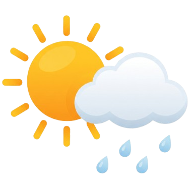

<div align="center">



# Weather · Какво ново

### [▶&nbsp; Отвори приложението](https://ivanovp.site)

Новостите в приложението за времето, най-новите най-отгоре

</div>

<br />

## 📅 22 ноември 2026

**По-лесно за четене**
Текстът навсякъде е по-едър и по-плътен, а разстоянията между нещата са по-малки, така че на екрана се събира повече. Когато снимката отзад е светла (слънце, облаци, мъгла, сняг), текстът горе е чисто бял и се чете ясно. До голямата температура вече пише „°C“.

**Изгрев и залез**
Картата „Sun“ показва изгрева и залеза на два отделни реда, всеки със своя иконка, плюс колко е дълъг денят. Вече не може да се объркат.

**Почасовата прогноза**
Вижда се още част от следващия час, за да е ясно, че лентата се плъзга. Стрелките отстрани вече се натискат, а тънката линия отдолу показва докъде си стигнал.

**Подробностите за час и за ден**
Когато натиснеш час или ден, прозорецът е наполовина по-кратък: остава само важното, в малки карти по две на ред. Видимост, гръмотевици, сняг и UV се показват само когато има смисъл. Графиката е с плавни линии и се движи плавно под пръста. Прозорецът се отваря и затваря плавно, като в истинско приложение.

**Последните 7 дни**
До „14-Day Forecast“ има ново копче „Past 7 days“. Показва как е било времето през последната седмица, най-отгоре вчера: колко е валяло, колко е духало и най-ниската и най-високата температура.

**Дребни неща**
- На iPhone търсачката вече не се скрива зад горния ръб на екрана.
- Посоката на вятъра е изписана с букви (например NW).
- Текстът в приложението не се маркира случайно при задържане на пръста.

Ако не виждаш промените, затвори приложението и го отвори пак.

### За Viber (копирай всичко в кутията)

```
🆕 *Ново в приложението за времето*

🔠 *По-лесно за четене*
По-едър и по-плътен текст навсякъде. На светли снимки горе всичко е чисто бяло. До температурата вече пише °C.

🌅 *Изгрев и залез*
На два отделни реда, всеки със своя иконка, плюс колко е дълъг денят.

🕐 *Почасовата прогноза*
Стрелките отстрани се натискат, а линията отдолу показва докъде си стигнал.

📋 *Подробности за час и ден*
Наполовина по-кратко, само важното. Плавна графика и плавно отваряне и затваряне.

📅 *Последните 7 дни*
Ново копче „Past 7 days“ до 14-дневната прогноза: колко е валяло, колко е духало и температурите за всеки ден от седмицата.

📱 На iPhone търсачката вече не се скрива зад горния ръб.

Ако не виждаш промените, затвори приложението и го отвори пак 🙂

👉 https://ivanovp.site
```
